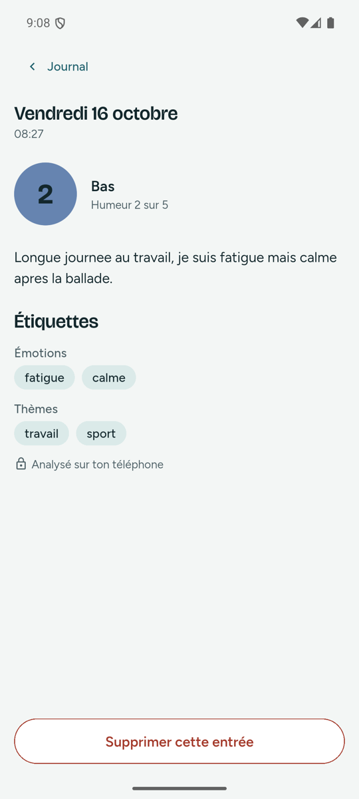
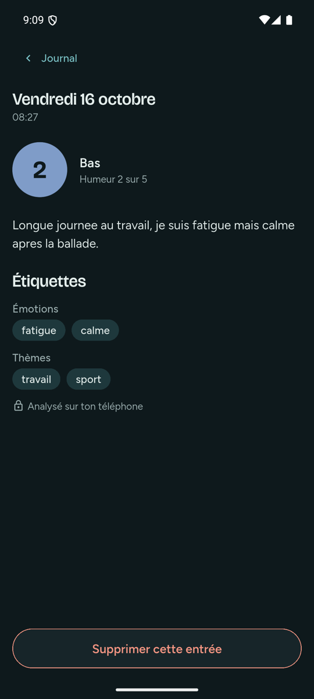
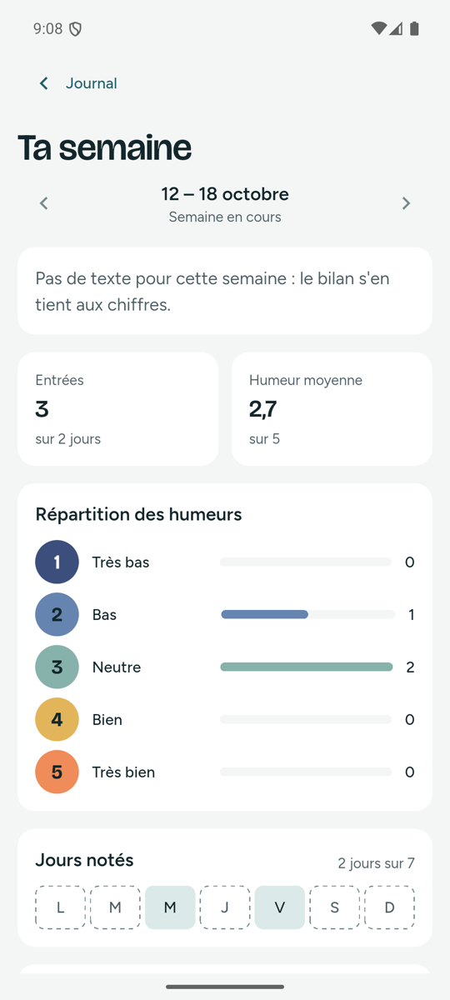
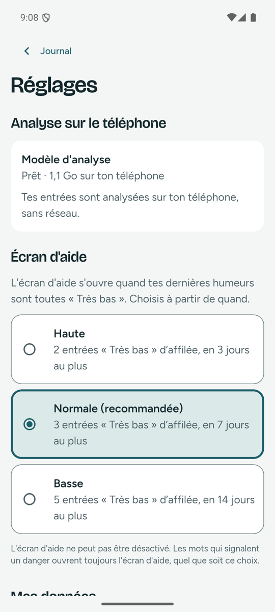
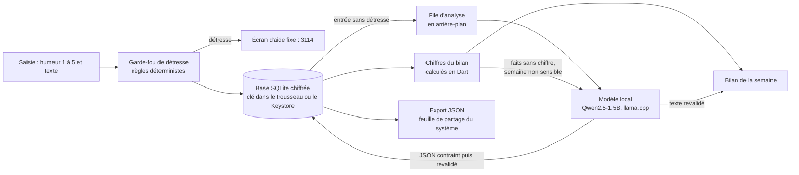

# Tidemark

Journal d'humeur mobile (Flutter, iOS et Android) dont l'IA tourne entièrement sur le téléphone : un modèle de langage local étiquette chaque entrée et met en mots le bilan de la semaine, sans qu'aucune donnée ne quitte l'appareil, sauf l'export que la personne déclenche elle-même.

Projet de démonstration, fictif, planifié sur 3 semaines (13 octobre → 3 novembre 2026) et construit avec une chaîne de développement agentique ; les six fonctionnalités sont mergées depuis le 16 octobre. Toutes les données montrées sont fictives.

## Démo

> **GIF sur l'iPhone 15 Pro : à venir, filmé par Yanis.**

Captures de l'app réelle sur l'émulateur Android (Pixel 7, API 35), modèle local chargé :

| Entrée étiquetée par le modèle local | Même écran, thème sombre | Bilan de la semaine | Réglages |
| --- | --- | --- | --- |
|  |  |  |  |

Chaque écran a d'abord été dessiné en maquette (artefact Claude, sur la charte du projet), validé avec sa spec, puis transcrit en Flutter : sources HTML dans [`docs/maquettes/`](docs/maquettes/). Les captures PNG des maquettes, pour les comparer à l'app côte à côte, restent à produire ([issue #20](https://github.com/yanis-vroland/Tidemark/issues/20)).

## Comment ça marche



Le seul accès réseau de l'app est le téléchargement du modèle (1,1 Go), sur l'appui de la personne, depuis une URL épinglée de Hugging Face, empreinte SHA-256 vérifiée. Un test refuse tout client réseau Dart hors de `lib/model/` (le code natif n'est pas couvert, voir « Limites »). La suppression totale efface les entrées, la clé et le modèle. Détails : [architecture technique](docs/architecture-technique.md).

## Notions d'IA mises en œuvre

- **LLM local quantifié** : Qwen2.5-1.5B-Instruct en GGUF Q4_K_M (environ 4 à 5 bits par poids, 1,1 Go), exécuté par llama.cpp via `llamadart`, GPU Metal sur iOS. Il est isolé derrière une interface (`MoodAnalyzer`) : les tests et la CI n'exécutent jamais de vrai modèle, seulement une implémentation factice.
- **Sortie contrainte par schéma JSON, puis revalidée** : le schéma porte la liste fermée des étiquettes, le modèle ne peut pas en inventer. L'app revalide quand même la sortie ; une réponse non conforme laisse l'entrée sans étiquette, sans plantage.
- **Garde-fou déterministe avant le modèle** : une entrée qui signale une détresse n'est jamais envoyée au modèle et ouvre un écran d'aide fixe (3114), jamais un texte généré. Des règles plutôt qu'un classifieur : un modèle ajouterait des faux négatifs difficiles à tester.
- **« L'app calcule, le modèle met en mots »** : tous les chiffres du bilan sont calculés en Dart. Le modèle ne reçoit que des faits sans chiffre et son texte n'est montré que s'il passe des règles fixes (aucun chiffre, aucun conseil, aucune détresse, 300 caractères au plus) ; sinon le bilan s'en tient aux chiffres. Une semaine sensible (humeur « Très bas », détresse détectée, entrée non analysée) n'est jamais envoyée au modèle : c'est le cas de la capture, dont la semaine contient des entrées de test du garde-fou.

## Lancer le projet

Prérequis : Flutter 3.47.7, Xcode (iOS 16.4+) ou Android SDK, un appareil ou un émulateur.

```sh
git clone https://github.com/yanis-vroland/Tidemark.git && cd Tidemark
flutter pub get
flutter run
```

Le premier build télécharge les moteurs natifs de SQLite3MultipleCiphers et de llama.cpp. Dans l'app, le modèle se télécharge depuis les Réglages. Tests : `flutter test` (aucun modèle requis).

## Mesures

Spike du moteur d'IA, 20 entrées fictives en français par configuration ([ADR-001](docs/adr/001-moteur-ia-local.md), mesures brutes dans [`docs/adr/001-mesures/`](docs/adr/001-mesures/)). Configuration retenue sur l'iPhone 15 Pro :

| `llamadart` + schéma JSON | JSON valides | Rappel des étiquettes | Médiane par entrée | Premier chargement |
| --- | --- | --- | --- | --- |
| GPU (Metal) | 20/20 | 0,51 | 0,83 s | 12,2 s (0,3 s relancé) |
| Processeur seul | 20/20 | 0,47 | 1,78 s | 3,5 s |

- 80 réponses valides sur 80 avec cette configuration (iPhone avec et sans GPU, simulateur iOS, émulateur Android), et 20/20 en mode avion.
- Arbitrage assumé : `flutter_edge_ai` sans contrainte retrouvait plus d'étiquettes (rappel 0,60 sur iPhone), mais sans garantie sur sa sortie (2 réponses invalides sur 20 sur simulateur et émulateur). La sortie toujours valide a été préférée.
- Limites : 20 entrées par série seulement ; le rappel (environ la moitié des étiquettes attendues retrouvées) est mesuré sur des étiquettes choisies pour le spike, c'est un indicateur de comparaison, pas une qualité absolue. L'étiquetage reste une aide, jamais un diagnostic.
- App réelle sur l'émulateur Android : modèle téléchargé en 4 minutes environ (Wi-Fi du Mac), empreinte identique à celle épinglée ; sur deux entrées essayées le 16 octobre (émulateur à 2 Go de mémoire), l'une a reçu quatre étiquettes (captures ci-dessus), l'autre aucune, ce que l'app affiche sans planter. Les temps d'un émulateur viennent du processeur du Mac et ne valent pas ceux d'un téléphone. La mesure sur 20 entrées avec l'app réelle reste à faire.

## Limites

- **Aucun Android physique** : Android n'est vérifié qu'en fonctionnement, sur émulateur, en processeur seul. Les performances ne valent que pour l'iPhone 15 Pro.
- **Tests humains en attente** : les six fonctionnalités sont implémentées et mergées, mais leur test humain sur l'iPhone et l'émulateur, maquette à côté, reste à faire ([cahier des charges](docs/cahier-des-charges-fonctionnel.md), statuts).
- **Binaire natif non vérifié** : le build télécharge llama.cpp sans contrôle d'empreinte, depuis une release GitHub modifiable ; au démarrage, le modèle n'est vérifié que par sa taille ([ADR-004](docs/adr/004-integrite-du-moteur-et-du-modele.md), proposé, en attente de décision).
- **Qualité de l'étiquetage** limitée par un modèle de 1,5 milliard de paramètres (voir « Mesures »).
- **Détection de détresse par règles seules** : une liste de termes rate les formulations qu'elle ne prévoit pas. Un classifieur local est une piste d'amélioration, écartée pour l'instant parce que ses faux négatifs seraient difficiles à tester.
- **Français seulement**, pas de dictée dans l'app (la reconnaissance vocale du système peut envoyer l'audio à un serveur). Le micro du clavier du système reste disponible dans le champ de texte et ne dépend pas de l'app.
- Pas de synchronisation ni de sauvegarde : supprimer l'app perd le journal, sauf export.
- L'app ne donne aucun conseil médical.

## Méthode

Construit avec la chaîne [agentic-dev-workflow](https://github.com/yanis-vroland/agentic-dev-workflow) : un agent de code (Claude Code) exécute, l'humain cadre, valide et merge.

- **Cadrage écrit** : [plan](docs/plan.md), [cahier des charges](docs/cahier-des-charges-fonctionnel.md), 6 [specs](docs/specs/) (204 critères d'acceptation), chacune avec sa maquette, et 5 [ADR](docs/adr/) (3 acceptés, 2 proposés).
- **Test-first** : les tests sont écrits à partir des critères d'acceptation et committés rouges avant l'implémentation. 1 658 tests (70 fichiers), aucun ne charge le vrai modèle.
- **Garde-fous testés par mutation** : une protection (aucune couleur en dur, aucun code réseau hors du téléchargeur, partage seulement sur un appui, file d'analyse…) est désactivée une fois pour vérifier qu'un test échoue. Des mutations ont survécu (trois sur l'étiquetage, une sur 31 pour l'export et la suppression) : des tests ont été ajoutés pour les tuer. Résultats dans les journaux.
- **Revues IA** : revue IA en CI à l'ouverture de chaque PR depuis la #2, subagents `reviewer` et `security-reviewer` avant les PR de fonctionnalité, et un commentaire « Réponse à la revue IA » qui donne une suite à chaque point. Une PR (#23) a été mergée avant ses revues : rattrapées par les PR #24 et #26.
- **Traçabilité** : 27 PR mergées, un journal par branche dans [`docs/journal/`](docs/journal/) ; le dépôt est la seule mémoire de l'agent. Certaines entrées renvoient à `docs/projets/`, notes privées de l'espace de travail de l'auteur, hors de ce dépôt.

## Licence

[MIT](LICENSE). Licences du modèle (Apache-2.0), des polices (OFL), des icônes et des dépendances : [`docs/licences.md`](docs/licences.md).
