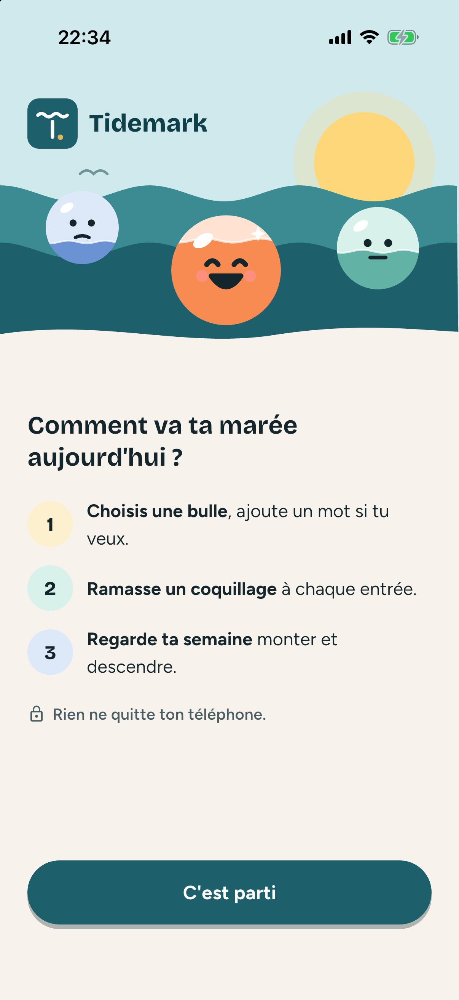
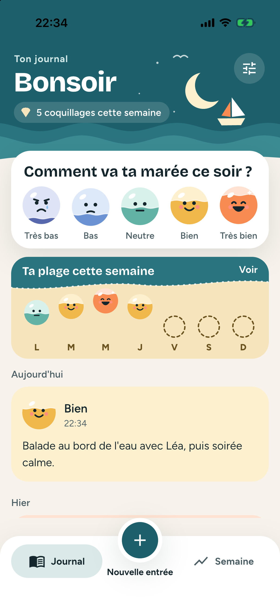
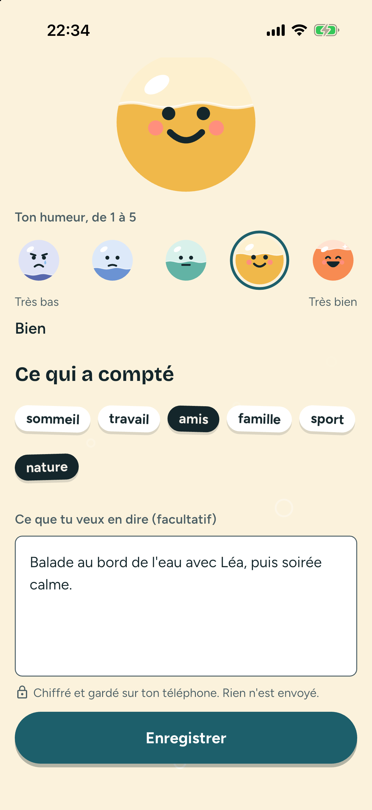
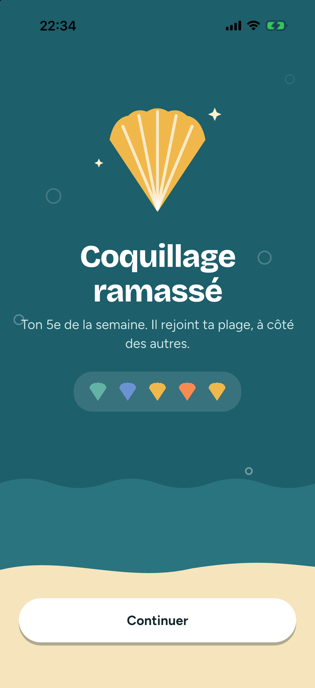
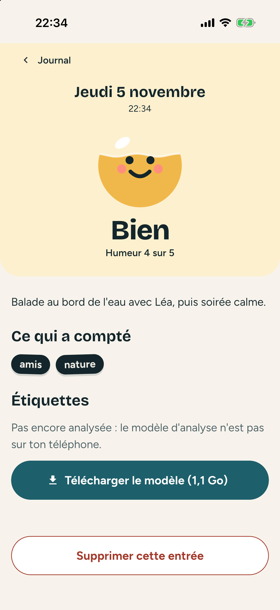
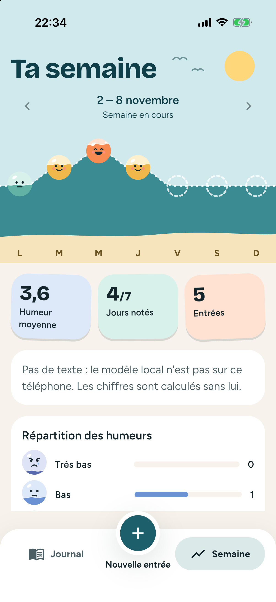
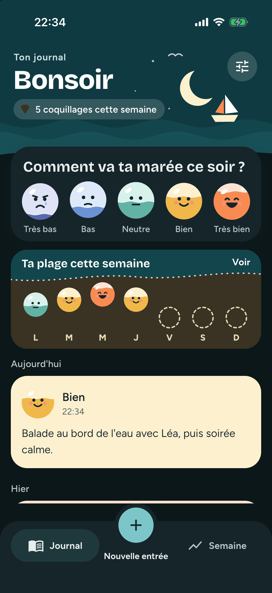
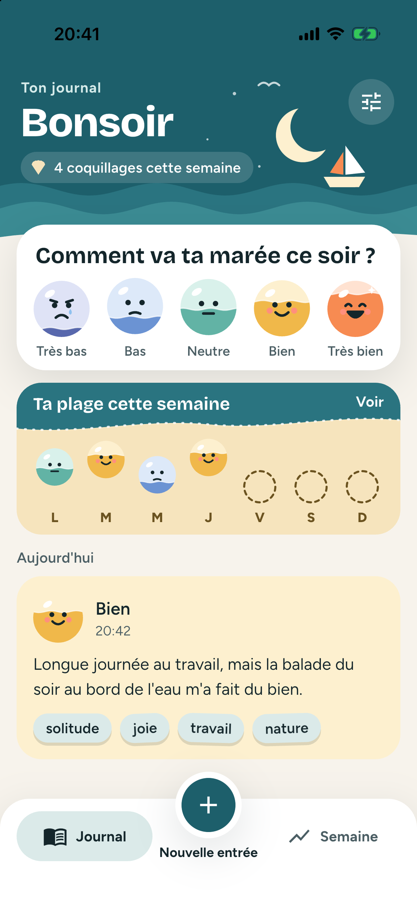
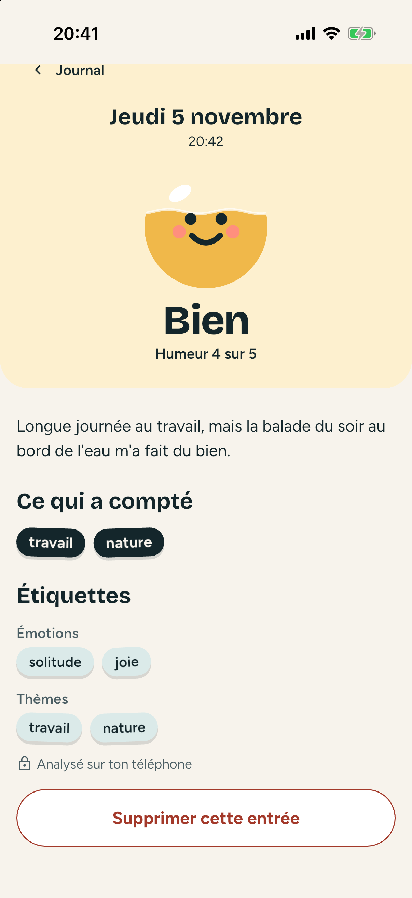
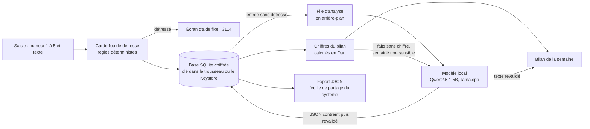

<p align="center"></p>

<h1 align="center">Tidemark</h1>

Journal d'humeur mobile (Flutter, iOS et Android) dont l'IA tourne entièrement sur le téléphone : un modèle de langage local étiquette chaque entrée et met en mots le bilan de la semaine, sans qu'aucune donnée ne quitte l'appareil, sauf l'export que la personne déclenche elle-même.

Projet de démonstration, fictif, planifié sur 3 semaines (13 octobre → 3 novembre 2026) et construit avec une chaîne de développement agentique ; les six fonctionnalités sont mergées depuis le 16 octobre, puis l'interface a été refondue le 5 novembre (« la marée de ton humeur » : bulles d'humeur animées, plage de la semaine, coquillages). Toutes les données montrées sont fictives.

## Démo

<p align="center"></p>

<p align="center"><em>Une soirée dans Tidemark, sur le simulateur iOS (iPhone 17 Pro), avec l'app réelle, des données fictives et le vrai modèle local (Qwen2.5-1.5B), téléchargé par l'app elle-même avant le tournage (59 s, empreinte vérifiée). L'étiquetage de l'entrée et la mise en mots du bilan sont filmés tels quels : 4,5 s entre « Enregistrer » et les étiquettes, chargement du modèle compris, et 6 s pour le texte du bilan, mesurés sur le simulateur, donc avec le processeur du Mac (Apple M3), pas celui d'un téléphone. Au montage, les touchers sont accélérés ×1,4 à ×1,5, la frappe ×2 et l'attente du bilan ×1,5 ; l'apparition des étiquettes sur l'accueil et la lecture du bilan sont en vitesse réelle. Les trois entrées des jours précédents ont été étiquetées par le même modèle avant le tournage. <a href="docs/demo/tidemark.mp4">Vidéo en MP4</a> (36 s).</em></p>

Captures de l'app réelle sur le simulateur iOS, refonte « la marée de ton humeur » ([specs 008 à 010](docs/specs/)) :

| Bienvenue | Accueil du soir | Saisie | Coquillage ramassé |
| --- | --- | --- | --- |
|  |  |  |  |

| Détail d'une entrée | Ta semaine | Accueil, thème sombre |
| --- | --- | --- |
|  |  |  |

| Accueil, entrée étiquetée | Détail, étiquettes du modèle local |
| --- | --- |
|  |  |

L'ancien design reste visible dans les [captures Android du 16 octobre](docs/captures/), dont un détail étiqueté sur l'émulateur.

Chaque écran a d'abord été dessiné en maquette (artefact Claude, sur la charte du projet), validé avec sa spec, puis transcrit en Flutter : sources HTML dans [`docs/maquettes/`](docs/maquettes/). Les captures PNG des maquettes, pour les comparer à l'app côte à côte, restent à produire ([issue #20](https://github.com/yanis-vroland/Tidemark/issues/20)).

## Comment ça marche



Le seul accès réseau de l'app est le téléchargement du modèle (1,1 Go), sur l'appui de la personne, depuis une URL épinglée de Hugging Face, empreinte SHA-256 vérifiée. Un test refuse tout client réseau Dart hors de `lib/model/` (le code natif n'est pas couvert, voir « Limites »). La suppression totale efface les entrées, la clé et le modèle. Détails : [architecture technique](docs/architecture-technique.md).

## Notions d'IA mises en œuvre

- **LLM local quantifié** : Qwen2.5-1.5B-Instruct en GGUF Q4_K_M (environ 4 à 5 bits par poids, 1,1 Go), exécuté par llama.cpp via `llamadart`, GPU Metal sur iOS. Il est isolé derrière une interface (`MoodAnalyzer`) : les tests et la CI n'exécutent jamais de vrai modèle, seulement une implémentation factice.
- **Sortie contrainte par schéma JSON, puis revalidée** : le schéma porte la liste fermée des étiquettes, le modèle ne peut pas en inventer. L'app revalide quand même la sortie ; une réponse non conforme laisse l'entrée sans étiquette, sans plantage.
- **Garde-fou déterministe avant le modèle** : une entrée qui signale une détresse n'est jamais envoyée au modèle et ouvre un écran d'aide fixe (3114), jamais un texte généré. Des règles plutôt qu'un classifieur : un modèle ajouterait des faux négatifs difficiles à tester.
- **« L'app calcule, le modèle met en mots »** : tous les chiffres du bilan sont calculés en Dart. Le modèle ne reçoit que des faits sans chiffre et son texte n'est montré que s'il passe des règles fixes (aucun chiffre, aucun conseil, aucune détresse, 300 caractères au plus) ; sinon le bilan s'en tient aux chiffres. Une semaine sensible (humeur « Très bas », détresse détectée, entrée non analysée) n'est jamais envoyée au modèle : c'est le cas de la capture, dont la semaine contient des entrées de test du garde-fou.

## Lancer le projet

Prérequis : Flutter 3.47.7, Xcode (iOS 16.4+) ou Android SDK, un appareil ou un émulateur.

```sh
git clone https://github.com/yanis-vroland/Tidemark.git && cd Tidemark
scripts/setup.sh   # flutter pub get, puis moteur llama.cpp vérifié par SHA-256
flutter run
```

`scripts/setup.sh` enchaîne `flutter pub get` et `scripts/fetch-llama-native.sh`, qui télécharge les archives de llama.cpp utilisées par `llamadart` et les compare aux empreintes épinglées dans `scripts/llama-native.sha256` ; sans ces archives, la construction échoue. Le script revérifie les archives à chaque lancement et efface la sortie gardée du hook, pour que la construction suivante extraie l'archive qu'il vient de vérifier : le relancer après chaque clonage et avant toute construction destinée à être installée ou distribuée ; une construction lancée sans lui reprend le dossier tel qu'il est ([ADR-004](docs/adr/004-integrite-du-moteur-et-du-modele.md)). SQLite3MultipleCiphers est téléchargé au premier build par le hook de `sqlite3`, qui vérifie lui-même son empreinte. Dans l'app, le modèle se télécharge depuis les Réglages. Tests : `flutter test` (aucun modèle requis, moteur natif préparé par `scripts/setup.sh`).

## Mesures

Spike du moteur d'IA, 20 entrées fictives en français par configuration ([ADR-001](docs/adr/001-moteur-ia-local.md), mesures brutes dans [`docs/adr/001-mesures/`](docs/adr/001-mesures/)). Configuration retenue sur l'iPhone 15 Pro :

| `llamadart` + schéma JSON | JSON valides | Rappel des étiquettes | Médiane par entrée | Premier chargement |
| --- | --- | --- | --- | --- |
| GPU (Metal) | 20/20 | 0,51 | 0,83 s | 12,2 s (0,3 s relancé) |
| Processeur seul | 20/20 | 0,47 | 1,78 s | 3,5 s |

- 80 réponses valides sur 80 avec cette configuration (iPhone avec et sans GPU, simulateur iOS, émulateur Android), et 20/20 en mode avion.
- Arbitrage assumé : `flutter_edge_ai` sans contrainte retrouvait plus d'étiquettes (rappel 0,60 sur iPhone), mais sans garantie sur sa sortie (2 réponses invalides sur 20 sur simulateur et émulateur). La sortie toujours valide a été préférée.
- Limites : 20 entrées par série seulement ; le rappel (environ la moitié des étiquettes attendues retrouvées) est mesuré sur des étiquettes choisies pour le spike, c'est un indicateur de comparaison, pas une qualité absolue. L'étiquetage reste une aide, jamais un diagnostic.
- App réelle sur l'émulateur Android : modèle téléchargé en 4 minutes environ (Wi-Fi du Mac), empreinte identique à celle épinglée ; sur deux entrées essayées le 16 octobre (émulateur à 2 Go de mémoire), l'une a reçu quatre étiquettes ([capture](docs/captures/android-detail.png)), l'autre aucune, ce que l'app affiche sans planter. Les temps d'un émulateur viennent du processeur du Mac et ne valent pas ceux d'un téléphone. La mesure sur 20 entrées avec l'app réelle reste à faire.

## Limites

- **Aucun Android physique** : Android n'est vérifié qu'en fonctionnement, sur émulateur, en processeur seul. Les performances ne valent que pour l'iPhone 15 Pro.
- **Tests humains** : positifs le 2026-10-19 pour les six fonctionnalités et les PR #43 (marquage en échec) et #44 (empreinte par le système), toutes deux mergées avant leur test humain ([cahier des charges](docs/cahier-des-charges-fonctionnel.md), statuts). Le temps de l'empreinte de la #44 n'est pas mesuré sur l'iPhone. La refonte ludique (PR #49) a un test humain positif sur l'iPhone (2026-11-05), pas encore sur l'émulateur Android.
- **Intégrité du moteur et du modèle, et son coût** : llama.cpp est épinglé par SHA-256 (`scripts/fetch-llama-native.sh`) ; le hook de `llamadart` ne télécharge plus rien lui-même. Le modèle est revérifié par SHA-256 une fois par lancement, avant son premier chargement, par la bibliothèque du système (CryptoKit sur iOS, `MessageDigest` sur Android), avec repli sur un calcul Dart : environ 1 s sur un Mac M3, contre 9,4 à 23,9 s en Dart selon la charge du poste. Non mesuré sur l'iPhone ni sur Android ; ce temps retarde d'autant la première analyse ou le premier bilan d'un lancement. Un fichier remplacé entre cette vérification et le chargement passerait. Le garde-fou réseau ne lit que le Dart : pour le code natif (llama.cpp, SQLite3MultipleCiphers), seule la provenance est contrôlée ([ADR-004](docs/adr/004-integrite-du-moteur-et-du-modele.md)).
- **Qualité de l'étiquetage** limitée par un modèle de 1,5 milliard de paramètres (voir « Mesures »).
- **Détection de détresse par règles seules** : une liste de termes rate les formulations qu'elle ne prévoit pas. Un classifieur local est une piste d'amélioration, écartée pour l'instant parce que ses faux négatifs seraient difficiles à tester.
- **Français seulement**, pas de dictée dans l'app (la reconnaissance vocale du système peut envoyer l'audio à un serveur). Le micro du clavier du système reste disponible dans le champ de texte et ne dépend pas de l'app.
- Pas de synchronisation ni de sauvegarde : supprimer l'app perd le journal, sauf export.
- L'app ne donne aucun conseil médical.

## Méthode

Construit avec la chaîne [agentic-dev-workflow](https://github.com/yanis-vroland/agentic-dev-workflow) : un agent de code (Claude Code) exécute, l'humain cadre, valide et merge.

- **Cadrage écrit** : [plan](docs/plan.md), [cahier des charges](docs/cahier-des-charges-fonctionnel.md), 10 [specs](docs/specs/) (290 critères d'acceptation), chacune avec sa maquette, et 5 [ADR](docs/adr/), tous acceptés.
- **Test-first** : les tests sont écrits à partir des critères d'acceptation et committés rouges avant l'implémentation. 2 514 tests (111 fichiers), aucun ne charge le vrai modèle.
- **Garde-fous testés par mutation** : une protection (aucune couleur en dur, aucun code réseau hors du téléchargeur, partage seulement sur un appui, file d'analyse…) est désactivée une fois pour vérifier qu'un test échoue. Des mutations ont survécu (trois sur l'étiquetage, une sur 31 pour l'export et la suppression) : des tests ont été ajoutés pour les tuer. Résultats dans les journaux.
- **Revues IA** : revue IA en CI à l'ouverture de chaque PR depuis la #2, subagents `reviewer` et `security-reviewer` avant les PR de fonctionnalité, et un commentaire « Réponse à la revue IA » qui donne une suite à chaque point. Une PR (#23) a été mergée avant ses revues : rattrapées par les PR #24 et #26. La résolution d'un conflit au merge de la PR #37 a perdu du code et des phrases de spec, et laissé deux numéros de critères en double : constaté par la CI de `main`, réparé par la PR #41.
- **Refonte en autonomie, agents en parallèle** (specs 008 à 010, [PR #49](https://github.com/yanis-vroland/Tidemark/pull/49)) : maquette validée dans un artefact Claude, plan dans une [issue](https://github.com/yanis-vroland/Tidemark/issues/48), trois specs, tests rouges committés pour chacune, puis deux agents qui implémentent deux specs en même temps dans des copies de travail isolées, fusionnées ensuite. Revues `reviewer` et `security-reviewer`, et 12 mutations des nouvelles protections, toutes tuées (réduction des animations, écran d'aide sans élément ludique, jamais de célébration en cas de détresse…).
- **Traçabilité** : 40 PR mergées au 2026-11-05, un journal par branche dans [`docs/journal/`](docs/journal/) ; le dépôt est la seule mémoire de l'agent. Certaines entrées renvoient à `docs/projets/`, notes privées de l'espace de travail de l'auteur, hors de ce dépôt.

## Licence

[MIT](LICENSE). Licences du modèle (Apache-2.0), des polices (OFL), des icônes et des dépendances : [`docs/licences.md`](docs/licences.md).
