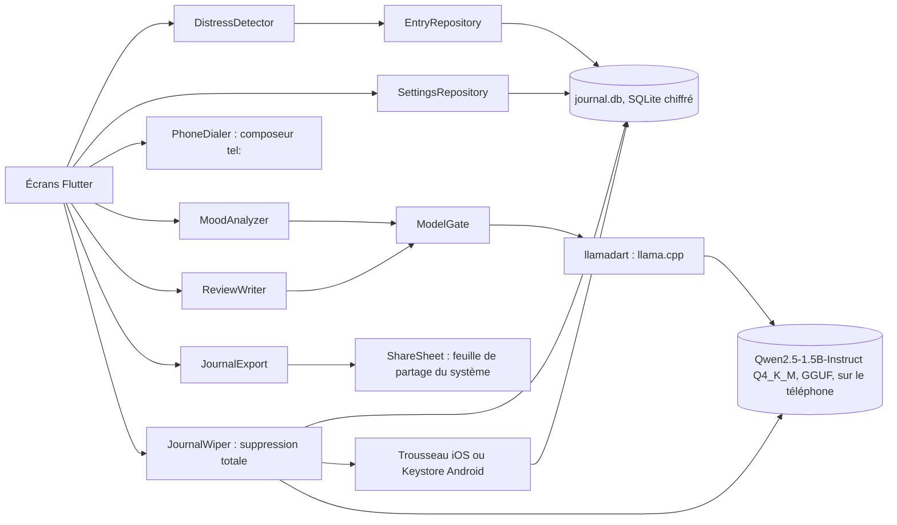
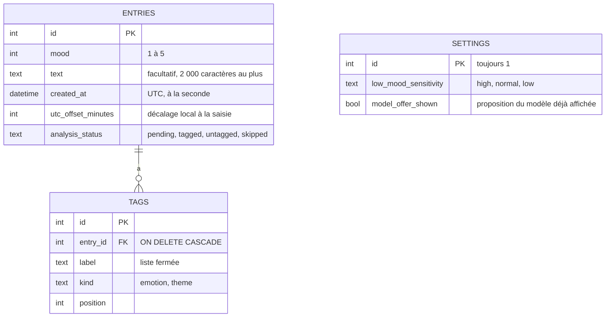

# Architecture technique

Comment le produit est construit : composants, données, contrats, sécurité et infrastructure. Ce document décrit l'état actuel. Le pourquoi de chaque choix est dans un ADR de `docs/adr/`, et les règles métier sont dans [`cahier-des-charges-fonctionnel.md`](cahier-des-charges-fonctionnel.md).

Il est mis à jour dans la PR qui change ce qu'il décrit : modèle de données, contrat, sécurité, infrastructure, ou ADR accepté. Une section sans objet pour le projet reste, avec « Sans objet » et une phrase d'explication.

## Vue d'ensemble

Une app Flutter (iOS 16.4+, Android) sans serveur. Les écrans lisent et écrivent les entrées par `EntryRepository`, sur une base `drift` chiffrée dont la clé est dans le trousseau ou le Keystore (spec 001). Chaque enregistrement passe par le garde-fou de détresse (`DistressDetector`, règles déterministes, spec 002) avant d'atteindre la base ; les réglages de la personne (`SettingsRepository`) sont dans la même base. Le moteur d'IA réel arrive avec la spec du lot G.

- **`MoodAnalyzer`** : interface qui isole le modèle local. Une implémentation factice sert aux tests et à la CI ; l'implémentation réelle repose sur `llamadart` 0.12.0, version épinglée exactement ([ADR-001](adr/001-moteur-ia-local.md)).
- **`ReviewWriter`** : interface qui met en mots le bilan de la semaine ([spec 006](specs/006-bilan-de-la-semaine.md)), à partir de faits sans chiffre (`ReviewFacts`) ; tous les chiffres sont calculés en Dart par `WeeklyReviewCalculator` (RM10). Sortie validée par `ReviewTextValidator` (règles déterministes), texte gardé en mémoire seulement (RM54). `LlamaReviewWriter` charge le modèle pour une mise en mots puis le libère ; `FakeReviewWriter` sert aux tests.
- **Accès au modèle** : `ModelGate`, un verrou partagé par l'analyseur (de `prepare` à `release`) et par le rédacteur (le temps d'une mise en mots) : jamais deux générations ni deux modèles en mémoire ([ADR-005](adr/005-partage-du-modele-local.md), proposé).
- **Sortie** : contrainte par un schéma JSON qui porte la liste fermée des étiquettes (RM19), puis validée par l'app (RM9).
- **Accélération** : GPU (Metal) sur iOS ; processeur seul sur Android tant que le GPU n'est pas vérifié sur un appareil réel.
- **Modèle** : 1 117 320 736 octets (« 1,1 Go »), téléchargé une fois sur l'appui de la personne (RM11, RM18) par `HttpModelDownloader` dans `Application Support/tidemark/models/`, empreinte SHA-256 vérifiée avant le renommage du fichier, puis recalculée une fois par lancement avant la première lecture par llama.cpp, dans un isolat ([spec 003](specs/003-telechargement-du-modele.md), [ADR-004](adr/004-integrite-du-moteur-et-du-modele.md)) ; chargé en arrière-plan (jusqu'à 12 s au premier chargement sur iPhone 15 Pro).

## Modèle de données

Base SQLite chiffrée (`drift`, SQLite3MultipleCiphers, [ADR-002](adr/002-stockage-local-chiffre.md)), fichier `Application Support/tidemark/journal.db`, exclu des sauvegardes. Les noms sont ceux du glossaire.

Schéma en version 4 : la version 2 crée la table `settings` (spec 002), la version 3 y ajoute `model_offer_shown` (spec 003), la version 4 crée la table `tags` (spec 004). `PRAGMA foreign_keys = ON` à chaque ouverture, pour la suppression en cascade des étiquettes.

| Entité | Contraintes et invariants | Règle métier |
| --- | --- | --- |
| `Entry` (table `entries`) | `mood` entre 1 et 5 (contrainte `CHECK`) ; texte absent plutôt que vide ; date de saisie en UTC avec le décalage local, pour ranger l'entrée dans son jour local ; statut décidé par le garde-fou : `skipped` sans texte ou en détresse, `pending` sinon | RM3, RM13, RM16, RM17, RM24, RM27 ([spec 001](specs/001-saisie-et-liste-des-entrees.md), [spec 002](specs/002-garde-fou-detresse.md)) |
| Réglages (table `settings`) | Une seule ligne (`CHECK id = 1`) ; degré stocké par son nom ; absent ou inconnu → `normal`, jamais désactivé ; proposition du modèle affichée une seule fois | RM25, RM29, RM31 ([spec 002](specs/002-garde-fou-detresse.md), [spec 003](specs/003-telechargement-du-modele.md)) |

La table des étiquettes, liée aux entrées par clé étrangère avec suppression en cascade, arrive au lot G.

Fichiers de l'app ([spec 005](specs/005-export-et-suppression-totale.md)) ; dossier de la base et cache de l'app réunis dans `AppStorage` (`lib/storage/app_storage.dart`) :

| Chemin | Rôle |
| --- | --- |
| `Application Support/tidemark/journal.db` (et `-wal`, `-shm`, `-journal`) | Base chiffrée. |
| `Application Support/tidemark/installed` | Marqueur d'installation, fichier vide (RM45). |
| `Application Support/tidemark/wipe-pending` | Marqueur de suppression totale en cours (RM43). |
| `Application Support/tidemark/models/` | Modèle local et téléchargement partiel (spec 003). |
| `<cache>/tidemark-export/`, `<cache>/share_plus/` (Android) | Fichier d'export temporaire, purgé au démarrage et avant chaque export (RM41). `<cache>` : `getTemporaryDirectory` (Library/Caches sur iOS, `cacheDir` sur Android), non sauvegardé. |

## Contrats entre composants

Les composants ne communiquent que par ces contrats. Le fichier de contrat fait foi ; ce tableau dit où il se trouve et qui en dépend. Un changement de contrat exige une spec.

| Contrat | Producteur | Consommateurs | Format | Fichier |
| --- | --- | --- | --- | --- |
| `EntryRepository` | `DriftEntryRepository` ; `FakeEntryRepository` dans `test/support/` | Écrans, garde-fou (`saveEntryWithGuard`), vérification au démarrage | Interface Dart : `watchEntries`, `addEntry(mood, text, status)`, `deleteEntry`, `latestEntries(count)`, `pendingEntriesWithText`, `markSkipped(ids)`, `saveAnalysis(entryId, result)` (spec 004 : étiquettes et statut « étiquetée » dans une même transaction, ou statut « sans étiquette » ; sans effet si l'entrée n'existe plus ou n'est plus « en attente »), `allEntriesWithTags` (export, de la plus ancienne à la plus récente) | `lib/entries/entry_repository.dart` |
| `SettingsRepository` | `DriftSettingsRepository` ; `FakeSettingsRepository` dans `test/support/` | `SettingsScreen`, garde-fou | Interface Dart : `watchLowMoodSensitivity`, `readLowMoodSensitivity`, `setLowMoodSensitivity` | `lib/settings/settings_repository.dart` |
| `DistressDetector` | Code Dart pur, liste de termes reprise de la spec 002 (vérifiée par un test) | Garde-fou à l'enregistrement, vérification au démarrage, analyse (lot G, juste avant chaque appel au modèle) | `detectInText(text)`, `detectLowMoodSeries(latest, sensitivity)` | `lib/distress/` |
| `ModelDownloader` | `HttpModelDownloader` ; `FakeModelDownloader` dans `test/support/` | Écran du modèle, Réglages, saisie (proposition), démarrage, suppression totale (lot H), analyse (lot G) | Interface Dart : `watch`, `current`, `start`, `cancel`, `checkAtStartup`, `deleteModel`, `verifyAfterLoadFailure`, `verifyBeforeFirstLoad` (rend `true` si le modèle peut être chargé ; empreinte calculée une fois par lancement par `sha256OfFile`, dans un isolat ; appelée par `AnalysisQueue` avant chaque `prepare` et par `ReviewNarrator` avant le rédacteur) ; état `ModelState` (`ModelAbsent`, `ModelDownloading`, `ModelReady`) | `lib/model/model_downloader.dart` |
| `ModelTransport` | `IoModelTransport` (`dart:io`, seul code réseau de l'app) ; `FakeModelTransport` dans `test/support/` | `HttpModelDownloader` | `get(url, headers)` rend statut, `Location` et flux d'octets, sans suivre les redirections | `lib/model/model_transport.dart` |
| `PhoneDialer` | `UrlLauncherDialer` (`url_launcher`, `tel:`) ; `FakePhoneDialer` dans `test/support/` | `HelpScreen` | Interface Dart : `dial(number)` rend vrai si le composeur s'est ouvert | `lib/ui/phone_dialer.dart` |
| `AnalysisQueue` | `AnalysisQueue` (`ChangeNotifier`), créée et démarrée par `startApp` quand un analyseur existe | Liste et détail, par `AnalysisScope` (`InheritedNotifier`, `lib/ui/analysis_scope.dart`) | Classe Dart : `start`, `stop`, `currentEntryId` (entrée en cours d'analyse ou `null`), `state` (`AnalysisQueueState` : `idle`, `running`, `unavailable`), `whenIdle` (tests seulement) ; observe `EntryRepository.watchEntries` et `ModelDownloader.watch`, appelle `MoodAnalyzer` et `saveAnalysis` ([spec 004](specs/004-etiquetage-automatique.md)) | `lib/analysis/analysis_queue.dart` |
| `MoodAnalyzer` | `LlamaMoodAnalyzer` (`llamadart` 0.12.0) ; `FakeMoodAnalyzer` dans `test/support/` pour les tests | `AnalysisQueue` (spec 004) | Interface Dart : `prepare`, `analyze(text)` (rend `Tagged` ou `Untagged`, jamais d'exception), `cancel`, `release` | `lib/analysis/mood_analyzer.dart` |
| `ReviewWriter` | `LlamaReviewWriter` (`llamadart` 0.12.0) enveloppé par `GatedReviewWriter` ; `FakeReviewWriter` dans `test/support/` | `ReviewNarrator` (bilan de la semaine, spec 006) | Interface Dart : `write(ReviewFacts)` (rend `RawReview`, `ModelMissing` ou `WriterFailed`, jamais d'exception), `cancel` ; délai de 30 s et validation tenus par l'appelant | `lib/review/review_writer.dart` |
| `ModelGate` | `lib/model/model_gate.dart` | `GatedMoodAnalyzer`, `GatedReviewWriter`, créés ensemble dans `openJournal` | `acquire({abandon})` rend la fonction de libération, dans l'ordre d'arrivée ([ADR-005](adr/005-partage-du-modele-local.md), proposé) | `lib/model/model_gate.dart` |
| `LocalEngine` | Implémentation sur `llamadart` (seul code qui touche au modèle) ; moteurs factices dans les tests | `LlamaMoodAnalyzer` | Interface Dart : `generate(text)` (consigne et schéma de la spec 004), `cancelGeneration`, `dispose` ; `cancel()` de l'analyseur attend la génération, 5 s au plus, puis libère le moteur (spec 004, CA35) | `lib/analysis/llama_mood_analyzer.dart` |
| Cycle de vie de l'app | `appLifecycleStates()` (`AppLifecycleListener`) dans `main` ; flux factice dans les tests | `AnalysisQueue` (spec 004, CA32, CA33) | `Stream<AppLifecycleState>` passé à `startApp` : `hidden`, `paused`, `detached` interrompent la file, `resumed` la relance | `lib/main.dart` |
| Fichier d'export, version 1 | `JournalExporter` (`JournalExport` l'écrit dans le cache et le passe à `ShareSheet`) | La personne, hors de l'app (lecture, archivage) | JSON versionné par `formatVersion` ; tout changement l'augmente | Section « Format » de la [spec 005](specs/005-export-et-suppression-totale.md) |
| `ShareSheet` | `SharePlusShareSheet` (`share_plus` 13.3.1, ADR-003) ; `FakeShareSheet` dans `test/support/` | `JournalExport` (Réglages, « Exporter mes données ») | Interface Dart : `shareFile(file, mimeType)` ouvre la feuille de partage du système et rend la main à sa fermeture | `lib/export/share_sheet.dart` |
| `KeyStore` | `SecureKeyStore` (`flutter_secure_storage`) ; trousseaux en mémoire dans les tests | `openJournal`, `JournalWiper`, marqueur d'installation | Interface Dart : `read`, `write(key)`, `deleteAll` | `lib/storage/database_key.dart` |
| `WipeFiles` | `IoWipeFiles` (`dart:io`) ; variantes en échec dans les tests | `JournalWiper`, marqueur d'installation | Interface Dart : `createFile`, `deleteFile`, `deleteDirectory`, idempotents | `lib/wipe/journal_wiper.dart` |

## Conventions d'API

À ADAPTER : nommage des routes, format des erreurs, pagination, versionnement, dates. Si un ADR les fixe, le résumer et renvoyer vers lui.

## Sécurité

- **Identification** : sans objet. Pas de compte : l'app sert une seule personne, sur son téléphone.
- **Droits** : sans objet pour la même raison ; la protection repose sur le verrouillage du téléphone et le chiffrement de la base.
- **Audit** : sans objet. Aucun journal d'usage ni analytics (RM1).
- **Chiffrement** : base `drift` chiffrée par SQLite3MultipleCiphers, clé aléatoire de 256 bits dans le trousseau iOS ou le Keystore Android, base exclue des sauvegardes du système ([ADR-002](adr/002-stockage-local-chiffre.md)). Mis en œuvre par la spec 001 : `PRAGMA hexkey`, refus d'ouvrir sans SQLite3MultipleCiphers, `secure_delete`, clé `first_unlock_this_device` sur iOS et `resetOnError: false` sur Android, jamais de nouvelle clé si la base existe ; exclusion des sauvegardes par `allowBackup`, `fullBackupContent` et les règles d'extraction sur Android, `isExcludedFromBackup` sur le dossier de la base sur iOS. Le clavier n'apprend pas les mots du journal (`enableIMEPersonalizedLearning: false`).
- **Garde-fou de détresse** : règles déterministes, sans modèle (RM6) ; une entrée en détresse est enregistrée `skipped` et ne sera jamais transmise au modèle (RM8) ; l'écran d'aide est fixe (RM7). Le composeur s'ouvre par `tel:` (`url_launcher`), sans aucune connexion réseau (RM1) ; aucune déclaration native, puisque `canLaunchUrl` n'est pas utilisé.
- **Secrets** : aucun dans le dépôt ni dans l'app ; la seule clé est générée sur le téléphone. Seul `.env.example` serait versionné.
- **Réseau** : un seul accès, le téléchargement du modèle local ([spec 003](specs/003-telechargement-du-modele.md), RM1, RM30). URL HTTPS épinglée sur la révision `91cad511…` de `Qwen/Qwen2.5-1.5B-Instruct-GGUF` ; redirections suivies par l'app, au plus 5, seulement vers `huggingface.co`, `*.huggingface.co` et `*.hf.co`, en HTTPS sur le port 443. Requête `GET` sans cookie, sans `Range`, avec `User-Agent: Tidemark` et `Accept-Encoding: identity` seulement. Empreinte vérifiée au téléchargement, taille seule pour l'état affiché au démarrage, empreinte recalculée avant le premier chargement de chaque lancement ([ADR-004](adr/004-integrite-du-moteur-et-du-modele.md), option E). Tout le code réseau est dans `lib/model/` : un garde-fou de `test/guards/` refuse `HttpClient`, `Socket` et consorts ailleurs. Permission `INTERNET` dans le manifeste Android principal, pour ce seul usage ; dossier du modèle exclu des sauvegardes comme la base.
- **Chaîne d'approvisionnement du code natif** ([ADR-004](adr/004-integrite-du-moteur-et-du-modele.md), accepté par Yanis le 2026-10-16) : les bibliothèques natives tournent dans le processus de l'app, avec ses droits (clé de la base, journal déchiffré, réseau : permission `INTERNET` sur Android, aucune permission requise sur iOS) ; le garde-fou réseau de `test/guards/` ne lit que le Dart. Elles arrivent déjà compilées, à la construction de l'app, jamais sur le téléphone, et toutes sont vérifiées par empreinte SHA-256 :
  - SQLite3MultipleCiphers, par le hook de `sqlite3` 3.7.1 : empreinte épinglée dans le paquet, vérifiée au téléchargement et à chaque réutilisation du cache ;
  - llama.cpp (option A) : le hook de `llamadart` 0.12.0 ne télécharge rien. `pubspec.yaml` lui donne `llamadart_native_path: .llamadart-native/`, dossier non versionné que prépare `scripts/fetch-llama-native.sh` : il télécharge les archives de la release `v0.6.0-2` de `leehack/llamadart-native`, compare leur SHA-256 aux empreintes écrites dans le dépôt (`scripts/llama-native.sha256`, relevées sur le cache du poste et recoupées avec le champ `digest` de l'API de GitHub), refuse toute autre entrée dans le dossier (le hook utiliserait sans contrôle une bibliothèque déposée là) et revérifie à chaque lancement les archives déjà présentes. Le hook extrait l'archive à chaque construction ; sans elle, la construction échoue, sans repli sur un téléchargement. Cibles : `android-arm64`, `android-x64`, `ios-arm64`, `ios-arm64-sim`, `ios-x86_64-sim`, et l'hôte de `flutter test` (`macos-arm64` sur le poste, `linux-x64` en CI) ;
  - un seul moteur natif embarqué : `llamadart_native_runtimes: llama_cpp` écarte LiteRT-LM, que le hook retenait par défaut sans usage dans Tidemark (vérifié le 2026-10-16 : ni l'APK de débogage ni l'app iOS ne le contiennent) ;
  - limite : la vérification ne tient que si le script est lancé ; un `flutter run` sans lui utilise le dossier tel quel, contrôlé au dernier lancement du script. Les empreintes reposent sur la confiance accordée au premier téléchargement (release non immuable, sans attestation de construction).

  Le modèle GGUF, lu par le même code natif, est revérifié avant le premier chargement de chaque lancement (spec 003, CA34 à CA36). Les journaux de `llamadart` sont fixés à `none`, côté Dart et natif, avant chaque chargement (`silenceLlamaLogs`, spec 004 CA38).
- **Export** : seule voie de sortie d'une donnée de la personne, en clair, par la feuille de partage et sur son appui seulement (RM1, RM23, RM41, [ADR-003](adr/003-export-par-la-feuille-de-partage.md)). `share_plus` n'ouvre aucune connexion ; seul `lib/export/share_sheet.dart` l'importe, et seul `JournalExport` appelle `shareFile` (garde-fou de `test/guards/`). Fichier temporaire dans le cache, effacé à la fermeture de la feuille ; dossiers temporaires purgés au démarrage, avant chaque export et après un export en échec.
- **Suppression totale** : marqueur `wipe-pending`, puis file d'analyse arrêtée (modèle libéré), téléchargement annulé et base fermée, base effacée (`-wal`, `-shm`, `-journal`, puis `journal.db`), clé (`KeyStore.deleteAll`), dossier `models/`, dossiers temporaires d'export, marqueur effacé ; la clé toujours après la base. Tant que `wipe-pending` existe, la base n'est pas ouverte : la suppression reprend au démarrage (RM43, [spec 005](specs/005-export-et-suppression-totale.md)). Après une suppression, `AppHost` rejoue `startApp`, qui ouvre une base neuve avec une clé neuve.
- **Marqueur d'installation** : la parade de l'ADR-002 est précisée par la [spec 005](specs/005-export-et-suppression-totale.md) (RM45) : sans marqueur, la clé restée dans le trousseau n'est effacée que si aucune base n'existe, pour ne pas rendre illisible le journal d'une installation antérieure au marqueur.

## Infrastructure

- **Lancement local** : `flutter pub get`, `scripts/fetch-llama-native.sh` (moteur natif vérifié, à relancer après chaque clonage et à chaque montée de version de `llamadart`), puis `flutter run`, sur un simulateur, un émulateur ou un appareil. Aucun service à démarrer.
- **Environnements** : un seul, le téléphone. Pas de serveur.
- **CI** : deux workflows, hérités de la chaîne agentic-dev-workflow. `garde-fous.yml` teste les hooks et les scripts, contrôle le journal de la PR et cherche des secrets dans tout l'historique ; `ai-review.yml` lance la revue IA à l'ouverture de la PR, avec le modèle déclaré dans `.claude/agents/reviewer.md`. Aucun job requis sur `main` : les rulesets ne sont pas disponibles sur un dépôt privé sans GitHub Pro, la règle « seul Yanis merge » tient par discipline. `flutter.yml` teste les scripts du moteur natif, prépare le moteur vérifié (`scripts/fetch-llama-native.sh`, dossier mis en cache par `actions/cache` et revérifié à chaque exécution), efface du cache de pub tout moteur que le hook aurait téléchargé lui-même (`scripts/check-llama-hook-cache.sh --purge`), vérifie le format, lance l'analyse statique (`--fatal-infos`) et les tests, avec Flutter 3.47.7, puis contrôle que le hook n'a rien téléchargé (`scripts/check-llama-hook-cache.sh`, option B de l'ADR-004) ; les actions sont épinglées par SHA.
- **Construction** : chaque construction de l'app pour une cible (`flutter run`, `flutter build`, et `flutter test` pour l'hôte) lance les hooks de `sqlite3`, qui télécharge SQLite3MultipleCiphers depuis GitHub, et de `llamadart`, qui extrait llama.cpp des archives de `.llamadart-native/` ; contrôles décrits dans « Sécurité », « Chaîne d'approvisionnement du code natif » ([ADR-004](adr/004-integrite-du-moteur-et-du-modele.md)). Montée de version de `llamadart` : relire le hook, mettre à jour `scripts/llama-native.sha256` et le tag du script, recouper avec le `digest` de la release.
- **Déploiement** : À ADAPTER.

## Décisions d'architecture

| ADR | Titre | Statut |
| --- | --- | --- |
| [ADR-001](adr/001-moteur-ia-local.md) | Moteur d'IA local | accepté |
| [ADR-002](adr/002-stockage-local-chiffre.md) | Stockage local chiffré | accepté |
| [ADR-003](adr/003-export-par-la-feuille-de-partage.md) | Export par la feuille de partage | accepté |
| [ADR-005](adr/005-partage-du-modele-local.md) | Partage du modèle local entre l'étiquetage et le bilan | proposé |
| [ADR-004](adr/004-integrite-du-moteur-et-du-modele.md) | Intégrité du moteur natif et du modèle | proposé |
