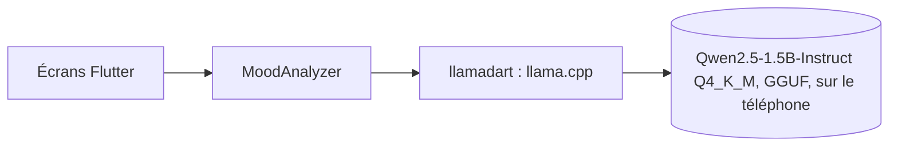
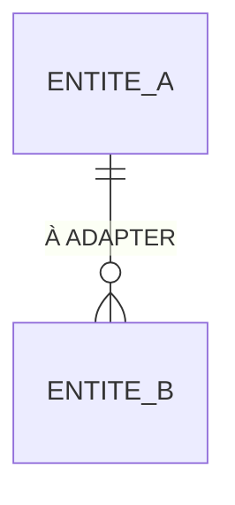

# Architecture technique

Comment le produit est construit : composants, données, contrats, sécurité et infrastructure. Ce document décrit l'état actuel. Le pourquoi de chaque choix est dans un ADR de `docs/adr/`, et les règles métier sont dans [`cahier-des-charges-fonctionnel.md`](cahier-des-charges-fonctionnel.md).

Il est mis à jour dans la PR qui change ce qu'il décrit : modèle de données, contrat, sécurité, infrastructure, ou ADR accepté. Une section sans objet pour le projet reste, avec « Sans objet » et une phrase d'explication.

## Vue d'ensemble

Une app Flutter (iOS 16.4+, Android) sans serveur. Le projet Flutter n'existe pas encore (lot D) : seul le composant d'IA est décidé.

- **`MoodAnalyzer`** : interface qui isole le modèle local. Une implémentation factice sert aux tests et à la CI ; l'implémentation réelle repose sur `llamadart` 0.12.0, version épinglée exactement ([ADR-001](adr/001-moteur-ia-local.md)).
- **Sortie** : contrainte par un schéma JSON qui porte la liste fermée des étiquettes (RM19), puis validée par l'app (RM9).
- **Accélération** : GPU (Metal) sur iOS ; processeur seul sur Android tant que le GPU n'est pas vérifié sur un appareil réel.
- **Modèle** : environ 1,1 Go, téléchargé une fois (RM11, RM18), chargé en arrière-plan (jusqu'à 12 s au premier chargement sur iPhone 15 Pro).

## Modèle de données

À ADAPTER : les entités, leurs relations et leurs contraintes. Les noms sont ceux du glossaire du cahier des charges.

| Entité | Contraintes et invariants | Règle métier |
| --- | --- | --- |
| À ADAPTER | | RMn |

## Contrats entre composants

Les composants ne communiquent que par ces contrats. Le fichier de contrat fait foi ; ce tableau dit où il se trouve et qui en dépend. Un changement de contrat exige une spec.

| Contrat | Producteur | Consommateurs | Format | Fichier |
| --- | --- | --- | --- | --- |
| À ADAPTER | | | OpenAPI, MCP… | |

## Conventions d'API

À ADAPTER : nommage des routes, format des erreurs, pagination, versionnement, dates. Si un ADR les fixe, le résumer et renvoyer vers lui.

## Sécurité

- **Identification** : À ADAPTER (qui s'identifie, comment).
- **Droits** : À ADAPTER (comment sont appliqués les droits décrits dans « Acteurs et droits » du cahier des charges).
- **Audit** : À ADAPTER (ce qui est journalisé : qui, quoi, quand).
- **Secrets** : À ADAPTER (où ils vivent ; jamais dans le dépôt, seul `.env.example` est versionné).

## Infrastructure

- **Lancement local** : À ADAPTER (commande, services démarrés).
- **Environnements** : À ADAPTER.
- **CI** : deux workflows, hérités de la chaîne agentic-dev-workflow. `garde-fous.yml` teste les hooks et les scripts, contrôle le journal de la PR et cherche des secrets dans tout l'historique ; `ai-review.yml` lance la revue IA à l'ouverture de la PR, avec le modèle déclaré dans `.claude/agents/reviewer.md`. Aucun job requis sur `main` : les rulesets ne sont pas disponibles sur un dépôt privé sans GitHub Pro, la règle « seul Yanis merge » tient par discipline. Le build et les tests Flutter s'ajouteront à la création du projet.
- **Déploiement** : À ADAPTER.

## Décisions d'architecture

| ADR | Titre | Statut |
| --- | --- | --- |
| [ADR-001](adr/001-moteur-ia-local.md) | Moteur d'IA local | accepté |
