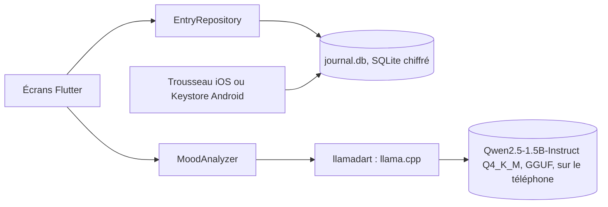
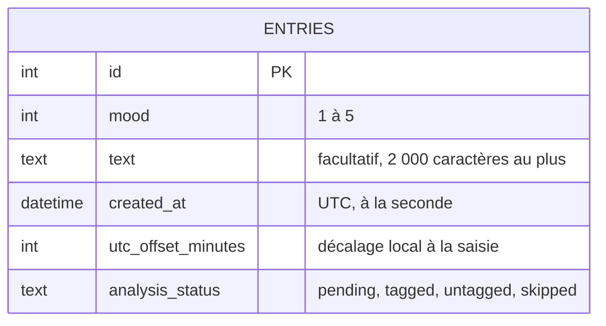

# Architecture technique

Comment le produit est construit : composants, données, contrats, sécurité et infrastructure. Ce document décrit l'état actuel. Le pourquoi de chaque choix est dans un ADR de `docs/adr/`, et les règles métier sont dans [`cahier-des-charges-fonctionnel.md`](cahier-des-charges-fonctionnel.md).

Il est mis à jour dans la PR qui change ce qu'il décrit : modèle de données, contrat, sécurité, infrastructure, ou ADR accepté. Une section sans objet pour le projet reste, avec « Sans objet » et une phrase d'explication.

## Vue d'ensemble

Une app Flutter (iOS 16.4+, Android) sans serveur. Les écrans lisent et écrivent les entrées par `EntryRepository`, sur une base `drift` chiffrée dont la clé est dans le trousseau ou le Keystore (spec 001). Le moteur d'IA réel arrive avec la spec du lot G.

- **`MoodAnalyzer`** : interface qui isole le modèle local. Une implémentation factice sert aux tests et à la CI ; l'implémentation réelle repose sur `llamadart` 0.12.0, version épinglée exactement ([ADR-001](adr/001-moteur-ia-local.md)).
- **Sortie** : contrainte par un schéma JSON qui porte la liste fermée des étiquettes (RM19), puis validée par l'app (RM9).
- **Accélération** : GPU (Metal) sur iOS ; processeur seul sur Android tant que le GPU n'est pas vérifié sur un appareil réel.
- **Modèle** : environ 1,1 Go, téléchargé une fois (RM11, RM18), chargé en arrière-plan (jusqu'à 12 s au premier chargement sur iPhone 15 Pro).

## Modèle de données

Base SQLite chiffrée (`drift`, SQLite3MultipleCiphers, [ADR-002](adr/002-stockage-local-chiffre.md)), fichier `Application Support/tidemark/journal.db`, exclu des sauvegardes. Les noms sont ceux du glossaire.

| Entité | Contraintes et invariants | Règle métier |
| --- | --- | --- |
| `Entry` (table `entries`) | `mood` entre 1 et 5 (contrainte `CHECK`) ; texte absent plutôt que vide ; date de saisie en UTC avec le décalage local, pour ranger l'entrée dans son jour local ; statut `pending` avec texte, `skipped` sans texte | RM3, RM13, RM16, RM24, RM27 ([spec 001](specs/001-saisie-et-liste-des-entrees.md)) |

La table des étiquettes, liée aux entrées par clé étrangère avec suppression en cascade, arrive au lot G.

## Contrats entre composants

Les composants ne communiquent que par ces contrats. Le fichier de contrat fait foi ; ce tableau dit où il se trouve et qui en dépend. Un changement de contrat exige une spec.

| Contrat | Producteur | Consommateurs | Format | Fichier |
| --- | --- | --- | --- | --- |
| `MoodAnalyzer` | Implémentation `llamadart` (lot G) ; `FakeMoodAnalyzer` dans `test/support/` pour les tests | Écrans de saisie et de détail (lots E, G) | Interface Dart : `analyze(text)` rend `Tagged` ou `Untagged`, jamais d'exception | `lib/analysis/mood_analyzer.dart` |

## Conventions d'API

À ADAPTER : nommage des routes, format des erreurs, pagination, versionnement, dates. Si un ADR les fixe, le résumer et renvoyer vers lui.

## Sécurité

- **Identification** : sans objet. Pas de compte : l'app sert une seule personne, sur son téléphone.
- **Droits** : sans objet pour la même raison ; la protection repose sur le verrouillage du téléphone et le chiffrement de la base.
- **Audit** : sans objet. Aucun journal d'usage ni analytics (RM1).
- **Chiffrement** : base `drift` chiffrée par SQLite3MultipleCiphers, clé aléatoire de 256 bits dans le trousseau iOS ou le Keystore Android, base exclue des sauvegardes du système ([ADR-002](adr/002-stockage-local-chiffre.md)). Mis en œuvre par la spec 001 : `PRAGMA hexkey`, refus d'ouvrir sans SQLite3MultipleCiphers, `secure_delete`, clé `first_unlock_this_device` sur iOS et `resetOnError: false` sur Android, jamais de nouvelle clé si la base existe ; exclusion des sauvegardes par `allowBackup`, `fullBackupContent` et les règles d'extraction sur Android, `isExcludedFromBackup` sur le dossier de la base sur iOS. Le clavier n'apprend pas les mots du journal (`enableIMEPersonalizedLearning: false`).
- **Secrets** : aucun dans le dépôt ni dans l'app ; la seule clé est générée sur le téléphone. Seul `.env.example` serait versionné.
- **Réseau** : aucun accès réseau dans l'app à ce jour. Le seul prévu est le téléchargement du modèle local, depuis Hugging Face, sans donnée de la personne ([spec 003](specs/003-telechargement-du-modele.md), RM30) ; il sera décrit ici avec son implémentation.

## Infrastructure

- **Lancement local** : `flutter pub get` puis `flutter run`, sur un simulateur, un émulateur ou un appareil. Aucun service à démarrer.
- **Environnements** : un seul, le téléphone. Pas de serveur.
- **CI** : deux workflows, hérités de la chaîne agentic-dev-workflow. `garde-fous.yml` teste les hooks et les scripts, contrôle le journal de la PR et cherche des secrets dans tout l'historique ; `ai-review.yml` lance la revue IA à l'ouverture de la PR, avec le modèle déclaré dans `.claude/agents/reviewer.md`. Aucun job requis sur `main` : les rulesets ne sont pas disponibles sur un dépôt privé sans GitHub Pro, la règle « seul Yanis merge » tient par discipline. `flutter.yml` vérifie le format, lance l'analyse statique (`--fatal-infos`) et les tests, avec Flutter 3.47.7 ; l'action `subosito/flutter-action` est épinglée par SHA.
- **Déploiement** : À ADAPTER.

## Décisions d'architecture

| ADR | Titre | Statut |
| --- | --- | --- |
| [ADR-001](adr/001-moteur-ia-local.md) | Moteur d'IA local | accepté |
| [ADR-002](adr/002-stockage-local-chiffre.md) | Stockage local chiffré | accepté |
